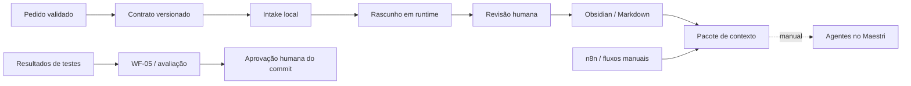

# Arquitetura

O diretório BrainNet já é um cofre Obsidian. A fundação usa esta raiz, sem criar um segundo cofre aninhado. Markdown é a fonte documental; código e JSON vivem em `automation/`, `scripts/`, `tests/` e `examples/`.

## Fronteiras
- **Obsidian:** requisitos, decisões, SOPs e evidências em ficheiros; não armazena credenciais.
- **Agentes:** recebem objetivo, caminhos relativos, restrições e aceitação; devolvem entregáveis e evidências. Papéis documentados em `04-Agents/`.
- **n8n:** prepara dados e propostas. Os três fluxos entregues só têm Manual Trigger e Code, além de notas.
- **Persistência:** CLI escreve diretórios completos via rename atómico. Hash SHA-256 do event_id define a pasta; fingerprint do registo normalizado deteta conflitos. Suporta concorrência no disco local; não promete exactly-once distribuído nem durabilidade contra falha elétrica.
- **Bridge futura:** consumidor local lê fila autenticada, prepara propostas e abre revisão. Nenhuma montagem do cofre inteiro dentro do n8n; nenhuma execução de comandos arbitrários recebidos.

## Comunicação implementada e planeada
| Ligação | Mecanismo | Estado |
| --- | --- | --- |
| JSON → CLI → rascunho | Contrato v1 e ficheiros locais | Implementado/testado |
| n8n → rascunho | Output do Code node | Implementado/testado |
| Rascunho → Obsidian | Revisão e promoção manual | Procedimento definido |
| Obsidian ↔ Maestri | Ficheiros por caminho e entregáveis | CLI localizado; sessão sem contexto de terminal Maestri. Ver [[../04-Agents/Maestri-Workspace|configuração do workspace]] |
| Serviços → n8n | Adaptadores autenticados por origem | Planeado |
| n8n → produção | Aprovação ligada a commit/ambiente | Não implementado |

## Escolhas
Node 22+ e módulos nativos evitam dependências para o piloto. Não se impõe base de dados externa nem chamadas de IA pagas. A persistência distribuída e integrações são incrementos separados quando houver requisitos reais de volume e acesso.

As recomendações de instalação, formato de exportação e limites de static data foram verificadas em [[../05-Workflows/Sources|fontes oficiais]]. Static data não é usado como mecanismo de idempotência.
