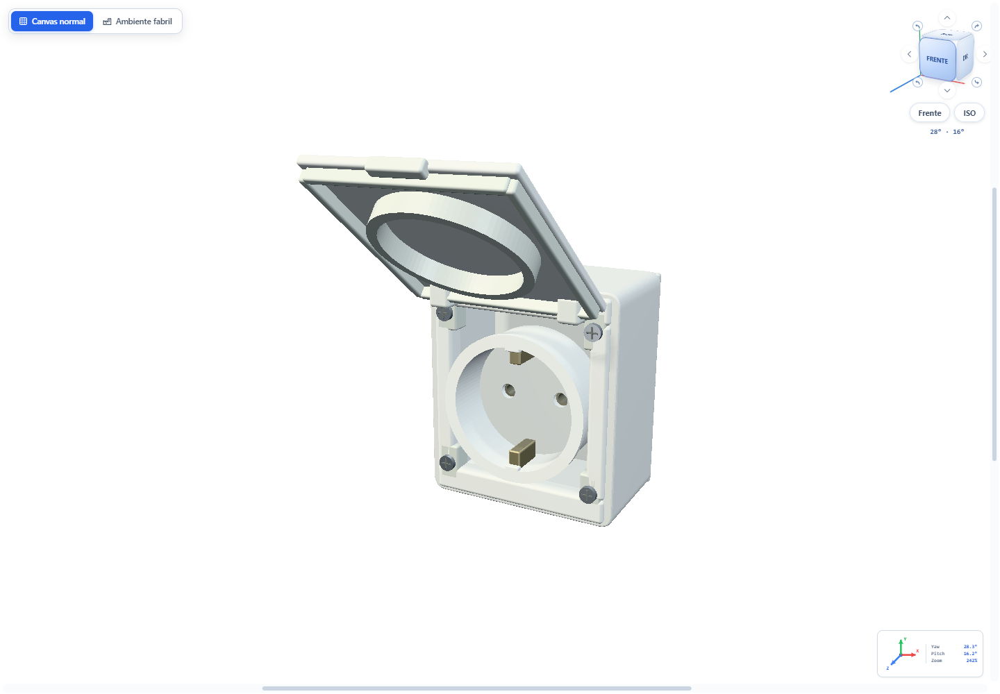
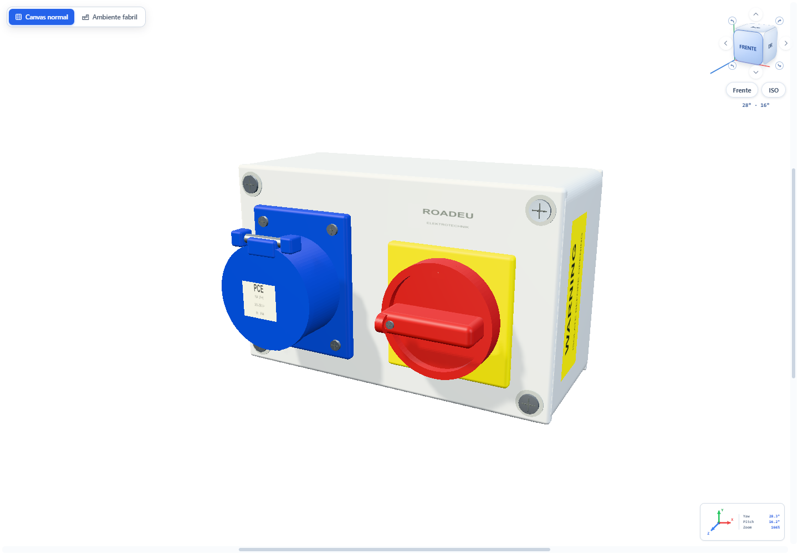
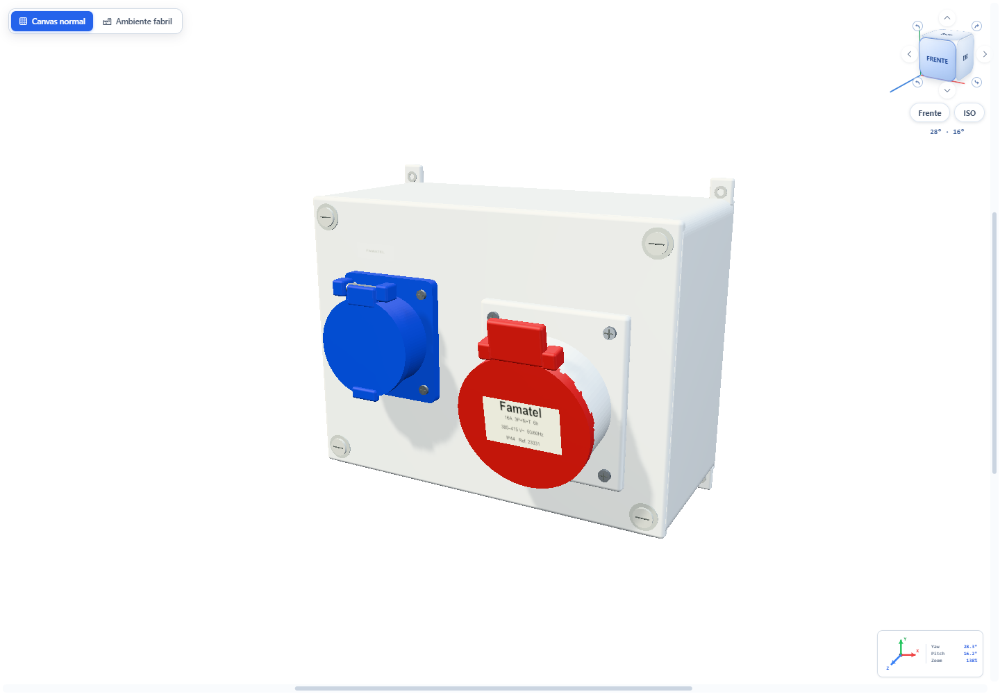
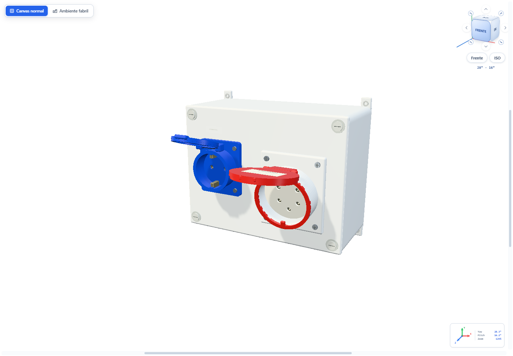

# Tomadas: capturas do modelo corrigido

Capturas do `Panel3D` real, produzidas por `scripts/socket-devices-ui-smoke.mjs`. As fotografias originais são as três referências fornecidas pelo utilizador na conversa de 22 de novembro de 2026. Estes PNG são renderizações da aplicação, não fotografias de produto.

As dimensões da caixa industrial FAMATEL e da caixa RoadEu são estimadas pelas fotografias; não se apresenta a reconstrução como CAD certificado. Ver o [relatório e fontes](../Validation-2026-11-22-Tomadas-Fidelidade.md).

## EFAPEL: tampa aberta, junta, parafusos, alvéolos e clips PE

## RoadEu: tomada CEE azul e seccionador vermelho/amarelo

## FAMATEL: Schuko azul e CEE 5 polos vermelha

