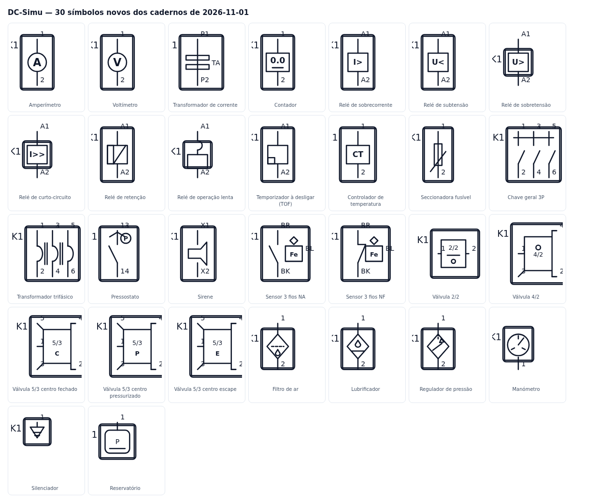

# Cadernos de símbolos «novos design e elementos» — 2026-11-01

## Pedido

«novos design e elementos» com oito cadernos digitalizados (elétrico IEC, comandos elétricos, pneumática/hidráulica ISO 1219, sensores de 3 e 4 fios e «Related Symbols»). O objetivo não é copiar a folha: é desenhar os elementos que faltam **com o traço do DC-Simu**, reaproveitar um tipo existente sempre que o caderno mostra algo que já existe e só criar tipos novos quando há um símbolo distinto.

## O que mudou

A biblioteca do Esquema IEC passa de **54 para 84 tipos** (`src/commands/model.ts` → `CMD_PARTS`), todos desenhados em `src/commands/symbols.tsx` com a geometria vertical do editor (bornes em `(0,0)` e `(0,60)`).

| Caderno | Elemento | Tipo novo | Desenho |
|---|---|---|---|
| image-10 | Amperímetro / voltímetro | `ammeter`, `voltmeter` | círculo de medida atravessado pelo condutor, letra A / V |
| image-10 | Transformador de corrente | `currentTransformer` | condutor contínuo + duas barras do núcleo + «TA», bornes `P1/P2` |
| image-10 | Relé de sobrecorrente / subtensão / sobretensão / curto-circuito | `overcurrentRelay`, `undervoltageRelay`, `overvoltageRelay`, `shortCircuitRelay` | caixa com a grandeza `I>`, `U<`, `U>`, `I>>`; bobina `A1/A2` |
| image-10 | Relé de retenção | `latchingRelay` | meia bobina escura + barra de remanência |
| image-10 | Relé de operação lenta | `slowRelay` | semicírculo do atraso em série com o enrolamento |
| image-10 | Relé de retardo à desenergização | `timerOffCoil` | bobina + bloco negro do atraso (TOF) |
| image-10 | Controlador de temperatura | `temperatureController` | caixa «CT» |
| image-10 | Seccionadora fusível | `fuseDisconnector` | cartucho + lâmina de corte manual (conduz, desliga por clique) |
| image-10 | Chave geral 3 pólos | `mainSwitch` | três polos do desenho de potência + barra mecânica, 6 bornes |
| image-10/11 | Trafo de potência trifásico | `threePhaseTransformer` | enrolamento por fase e núcleo comum entre fases |
| image-11 | TOF com bloco negro | (o mesmo `timerOffCoil`) | — |
| image-11 | Contador | `counter` | caixa com dígitos `0.0` e traço de pré-seleção |
| image-11 | Sirene | `siren` | trombeta com duas ondas de alarme |
| image-11 | Pressostato | `pressureSwitch` | contacto NA + círculo «P» |
| image-15 | Sensor 3 fios (BR/BK/BL) | `sensor3wNO`, `sensor3wNC` | contacto NA (light-on) ou NF (dark-on) + losango do filtro + cabeça «Fe»; bornes com as cores |
| image-12/13 | Válvula 2/2 | `valve22` | caixa com o traço de passagem e indicador de posição |
| image-12/13 | Válvula 4/2 | `valve42` | caixa de 4 vias com saídas 4/2 e escape 3 |
| image-12/13 | Válvulas 5/3 | `valve53c`, `valve53p`, `valve53e` | centro **fechado**, **pressurizado** e **escape** (letra C/P/E na posição central) |
| image-14 | Filtro de ar / lubrificador | `airFilter`, `airLubricator` | losango ISO 1219 com marca de água (tracejado + gota) ou de óleo |
| image-14 | Reguladora de pressão | `airRegulator` | losango com seta de redução e linha tracejada do ajuste |
| image-14 | Manómetro | `manometer` | mostrador com ponteiro e escala |
| image-14 | Silenciador | `silencer` | triângulo de escape com abafador |
| image-14 | Reservatório | `reservoir` | acumulador arredondado com nível |

Reaproveitados sem tipo novo (já existiam e o caderno confirma o desenho): disjuntor 1P/3P, relé térmico, fusível e fusíveis 3P, botoeiras NA/NF e luminosa, emergência, comutador, contactos NA/NF e comutador, temporizados TON (bobina e contactos), lâmpada, buzina, solenoide, motores 3~/6 bornes, díodo, ponte retificadora, transformador monofásico, válvula 3/2 e 5/2, cilindros, controlo de fluxo, válvula de retenção, bomba e depósito hidráulicos.

## Motor de simulação

- `COIL_KINDS` passa a reunir as bobinas de proteção: `coil`, `timerCoil`, `timerOffCoil`, `overcurrentRelay`, `undervoltageRelay`, `overvoltageRelay`, `shortCircuitRelay`, `slowRelay`, `latchingRelay`.
- `isClosed`: seccionadora fusível conduz até ser aberta (`toggled`), chave geral fecha por omissão, pressostato conduz quando actuado, sensores de 3 fios NA/NF seguem `pressed` e o filtro/lubrificador/regulador deixam passar caudal.
- `siren` e `counter` são cargas (`rt.loads`); os novos sensores, o pressostato e as válvulas entram em `MOMENTARY`/`TOGGLES` (`commandsUi.ts`), por isso aparecem no painel de entradas e saídas.

## Testes

- `npx tsc -b` — 0 erros.
- `npm test` — ✅ todos os testes passaram.
- `npm run -s test:commands-symbols` — PASS (blocos 8, 8a e 8b: bornes em y=0/y=60, textos `I>`, `U<`, `U>`, `I>>`, `CT`, `TA`, `Fe`, TOF e retenção escuros, condução coerente com o desenho).
- `node scripts/symbols-ui-smoke.mjs` — **12 verificações** (antes 9): biblioteca anuncia 84 símbolos, os 19 tipos novos estão na paleta e não há tipos órfãos.
- Sem erros JavaScript no browser.

## O que fica para depois (do mesmo lote de cadernos)

Sensores de 4 fios (GY/WH com light-on/dark-on), barreira de feixe e as oito variantes de difuso/retro-reflexivo do caderno «Related Symbols»; actuadores de válvula (solenoide + manual, alavanca com trava, pedal, piloto interno/externo, mola); secador, refrigerador, unidade de manutenção FRL e multiplicador de pressão. Registado no [[Backlog]] como `SYMBOLS-SHEETS-03`.

## Evidência

Render direto de `CmdSymbol` (sem a aplicação), vinte e nove cartões com a referência `K1` e os bornes à vista.

## Commits

- `dc-simu` `cf09d27` — instrumentos, relés de medida, seccionadora fusível, controlador, pressostato e sirene (11 tipos).
- `dc-simu` `8701991` — contador, relés de sobretensão/curto-circuito/operação lenta, chave geral, trafo 3~, sensores de 3 fios e pneumática ISO 1219 (19 tipos).

Decisão registada em [[Decision-Log]] `DC-ADR-081`.
