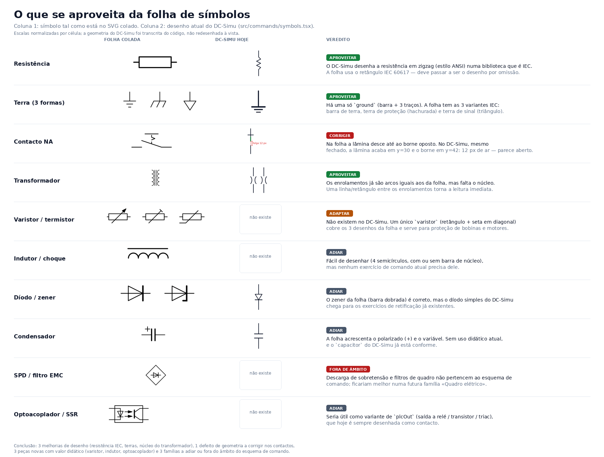
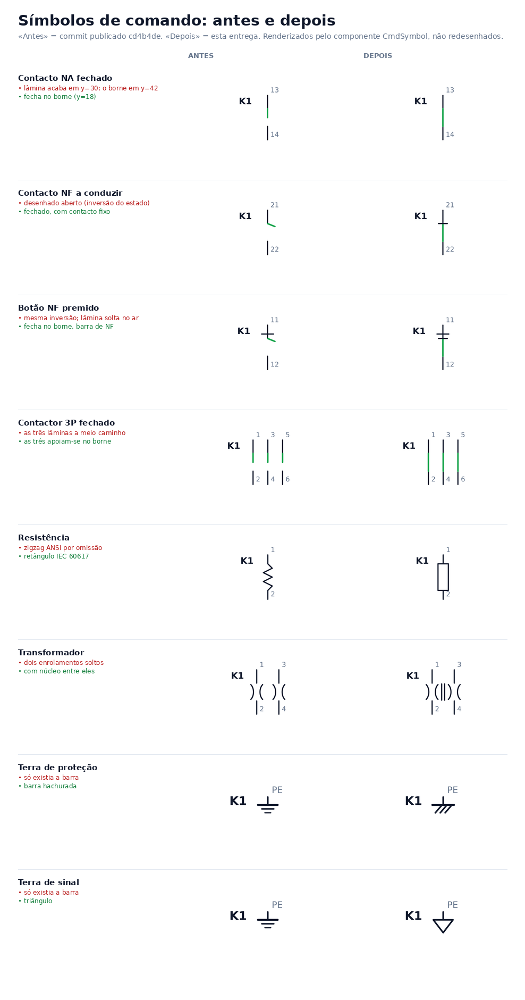

# Reaproveitamento da folha de símbolos SVG — 2026-11-01

## Pedido

«ver o que podemos aproveitar aqui» com um SVG colado (canvas 1000×750, ~49 grupos `<g>`, 206 `<path>`). Avaliar o que serve para a biblioteca de símbolos do esquema de comandos (`src/commands/model.ts` → `CMD_PARTS`, `src/commands/symbols.tsx`) antes de decidir qualquer alteração.

## O que a folha é — e o que não é

É uma **folha de componentes eletrónicos** desenhada à mão em Inkscape (resistências, condensadores, indutâncias, díodos, tiristores, filtros EMC, fichas), **não** uma folha de esquema de comando. Do conjunto:

- **Nada tem nomes**: os `id` são `path1450-1-5-3-4-1-6-1-6-1-5`, `g7334`, `g7527`… Não há `<use>`, nem grupos semânticos (`Resistor`, `Fuse`…). Só existe um `<text>`: «Resistors», colocado sobre o grupo dos condensadores.
- **Não há grelha nem bitola**: o passo vertical é irregular (50 px numa zona, 45/55 noutra) e o traço alterna `stroke-width:1`, `1.049` e `2` no mesmo símbolo.
- **Vários símbolos estão incompletos**: há setas de irradiação soltas em (395,87), (428,83) e (790,100) que pertenciam a símbolos óticos; a última forma da folha tem `d=` escrito **dentro** do atributo `style` (ou seja, o `<path>` não tem geometria); e o recorte colado termina em `</g>`, sem `</svg>`.
- Para renderizar e comparar, **fechei o `<svg>` e corrigi esse `d=` num ficheiro de trabalho**. A folha original não foi alterada no repositório.

Conclusão: não é uma biblioteca importável. Serve como **referência de desenho** — e mesmo assim só em metade dos casos.

## Correspondência com a biblioteca atual

`CMD_PARTS` tem **54 tipos**. A folha toca em 12 famílias:

| Folha | Desenho na folha | DC-Simu hoje | Veredito |
|---|---|---|---|
| Resistência | retângulo IEC 60617 | zigzag nativo (estilo ANSI) + retângulo IEC só no estilo `qet` (opt-in) | **Aproveitar** — o IEC deve ser a omissão |
| Terra | 3 variantes (barra, hachurada, triângulo) | 1 só (`ground`) | **Aproveitar** — faltam 2 |
| Contacto NA/NF | lâmina desce até ao borne oposto | folga de 12 px no estado fechado | **Corrigir** (defeito) |
| Transformador | 2 enrolamentos + núcleo (2 linhas) | 2 enrolamentos sem núcleo | **Aproveitar** — acrescentar núcleo |
| Varistor / termistor | 3 desenhos (retângulo + seta) | não existe | **Adaptar** — 1 `varistor` cobre os 3 |
| Indutor / choque | 2 desenhos | não existe | Adiar |
| Díodo, zener, LED, tiristor | 8 desenhos | díodo simples | Adiar |
| Condensador | fixo, polarizado, variável | fixo | Adiar |
| SPD / filtro EMC | 4 caixas | não existe | Fora de âmbito |
| Optoacoplador / SSR | 1 caixa (LED + fototransistor) | não existe (`plcOut` é sempre contacto) | Adiar |
| Fichas e bornes | 4 (círculo/losango com barra) | `node` é só um ponto | Adiar |
| Fusível | retângulo com linha | retângulo com linha | Nada a ganhar |

## Achados no DC-Simu (independentes da folha)

1. **Contactos com folga de 12 px.** Em `symbolBody` → `contactBody`, a lâmina vai de `y=18` até `y=30` quando fechada, mas o borne inferior só começa em `y=42`. Um contacto «fechado» aparece visualmente aberto. O mesmo acontece em `threePole` (`y2={closed ? 30 : 24}` com o mesmo `42`). Afeta `contactNO`, `contactNC`, `changeover`, `pushNO/NC/Illum`, `emergency`, `selector`, `limitNO/NC`, `proximity`, `timedNO/NC`, `thermalNC/NO`, `contact3`, `breaker1`, `breaker3`, `disconnector3`, `rcd`.
   Correção mínima: no ramo fechado, `y = 42` (e não `30`), nos dois sítios.
2. **A resistência nativa é ANSI.** Numa biblioteca anunciada como IEC 60617 / ISO 1219, o desenho por omissão é o zigzag americano; o retângulo IEC existe apenas como variante `qet` escolhida símbolo a símbolo. A folha confirma que, em contexto didático PT/ES, o esperado é o retângulo.
3. **`symbolStyle` só cobre 4 tipos.** O ramo `qet` de `symbolBody` trata apenas `fuse`, `resistor`, `capacitor` e `diode`; qualquer outro tipo com `symbolStyle:'qet'` cai no desenho nativo sem aviso. Ver [[Task-2026-10-31-Variantes-QElectroTech]].
4. **O transformador não tem núcleo**, o que o torna indistinguível de dois indutores acoplados à primeira vista.

## Proposta, por ordem de custo/benefício

| # | Alteração | Onde | Risco |
|---|---|---|---|
| P0 | Fechar a lâmina no borne (`y=42`) em `contactBody` e `threePole` | `symbols.tsx` | Nulo para a simulação; só geometria |
| P1 | Passar o retângulo IEC a desenho nativo da resistência e manter o zigzag como estilo opt-in | `symbols.tsx` | Nulo; modelos e bornes iguais |
| P2 | Núcleo do transformador (1 `<line>`) | `symbols.tsx` | Nulo |
| P3 | Terras: variante de proteção e de sinal (2 tipos novos ou um seletor de variante em `ground`) | `model.ts` + `symbols.tsx` + paleta | Baixo (sem polos, sem simulação) |
| P4 | `varistor` (retângulo + seta em diagonal, sem polos) | `model.ts`, paleta, `symbols.tsx`, normalização de importação | Médio (novo tipo: precisa de `CMD_PARTS`, `CMD_PALETTE` e testes de importação/exportação) |
| P5 | Optoacoplador/SSR como variante de `plcOut` | `symbolStyle` | Médio (toque no inspetor) |

P0–P2 são três alterações pequenas, no mesmo ficheiro, e são as que se notam em todos os esquemas. P3–P5 são decisões de produto.

## O que não fazer

- **Não copiar os `<path>` da folha.** A geometria é horizontal (bornes à esquerda/direita), o DC-Simu é vertical (`(0,0)`→`(0,60)`), e a folha não traz autor, fonte nem licença — a regra do projeto para desenho de terceiros está em `dc-simu/docs/third-party/qelectrotech/README.md` (autor, origem, revisão e adaptações). Redesenhar as ideias em geometria nativa evita a questão e garante a bitola.
- **Não trazer díodos, tiristores, condensadores variáveis, SPD ou filtros EMC** para o esquema de comando: não há exercício que os peça e cada tipo novo custa normalização, ícone, paleta e testes.

## Verificação feita nesta análise

- SVG renderizado com `cairosvg` e inspecionado zona a zona (4 recortes + 6 ampliações) para identificar os símbolos e não os adivinhar pela descrição.
- Geometria do DC-Simu transcrita de `src/commands/symbols.tsx` (constantes `INK`, largura 1.6) e desenhada lado a lado com a folha; a imagem acima é essa comparação, não uma maquete.
- **Não foi executado nenhum teste de software e não há alterações de código** nesta análise.

## Implementação (2026-11-01)

Aprovado o que a análise recomendava como risco nulo; implementado e publicado:

| # | Proposta | Estado |
|---|---|---|
| P0 | Lâmina do contacto apoia-se no borne, e o estado de condução deixa de ser invertido no desenho dos NF | Feito |
| P1 | Retângulo IEC por omissão na resistência; zigzag ANSI como variante no inspetor | Feito |
| P2 | Núcleo do transformador | Feito |
| P3 | Três terras (barra, proteção, sinal) no mesmo tipo e borne PE | Feito — como `groundVariant`, sem tipo novo |
| P4 | `varistor` | Não feito — pede tipo novo, paleta e normalização de importação |
| P5 | Optoacoplador/SSR como variante de `plcOut` | Não feito |

O P0 cresceu: ao escrever o teste geométrico apareceu que `st.closed` (que vem de `isClosed`) é o estado de **condução**, mas `contactBody` invertia-o outra vez para os NF — um NF a conduzir desenhava-se aberto e um NF aberto desenhava-se fechado. Ver [[Validation-2026-11-01-Simbolos-Comando-IEC]].

## Publicação

Os clones locais foram recuperados do GitHub depois de o ambiente ter perdido os `.git`, o código foi publicado em `dc-simu` e esta nota acompanha o ponteiro do submódulo em `BrainNet`. P4 e P5 continuam por decidir.
