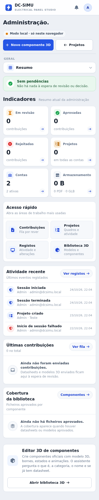
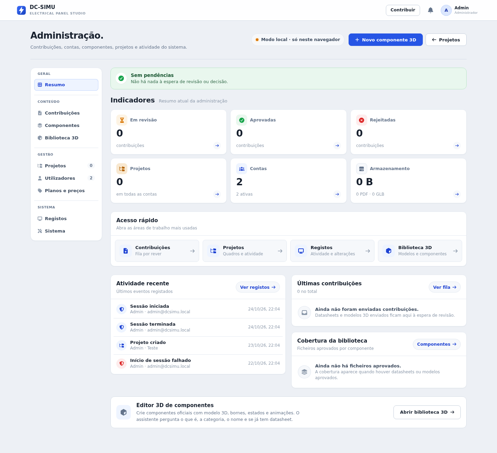

# Validação 2026-10-27 — Resumo da administração responsivo (mobile + desktop)

Trabalho pedido por Deogracia de Castro, com duas capturas do telemóvel (Resumo da
administração e atividade recente em `dc-simu.vercel.app`), com autorização
explícita para `git commit`, `git push` e publicação nos repositórios
`dc-simu` e `BrainNet`. Feito **no cofre**, no submódulo
`03-Projects/DC-Simu/dc-simu`, primeiro alinhado com o `main` publicado
(`17756aa` — o ponteiro do BrainNet estava em `0f57d38`). Fecha
**ADMIN-VISUAL-01** do [[Backlog]] e complementa
[[Validation-2026-10-27-Admin-Ecras-Pequenos]] (navegação/listas) e
[[Validation-2026-10-27-Admin-UI]] (estrutura).

## Problemas lidos nas capturas

| # | Problema | Efeito para quem usa |
| --- | --- | --- |
| 1 | «Modo local» à esquerda e «+ Novo componente 3D» / «← Projetos» empilhados na metade direita | metade do ecrã vazia; botões estreitos |
| 2 | «Sem pendências»: ponto verde sozinho numa linha por cima da frase (`flex-wrap`) | banner partido |
| 3 | Indicadores: no código nem sequer tinham ícone (só rótulo/número/detalhe) e os tons estavam trocados (aprovadas roxo, rejeitadas verde) | leitura lenta; cor contra o significado — viola [[Design-Principles]] |
| 4 | Acesso rápido: descrição cortada a meio da palavra («Acompanhar quadros qu…», `nowrap` + ellipsis) e seta esquerda rodada 180° por CSS | texto ilegível |
| 5 | Atividade: «Admin · admin@dcsimu.local» e outra vez «admin@dcsimu.local» (o alvo da sessão é o próprio ator), data em pílula na linha seguinte — ≈110 px por evento | repetição e percurso longo |
| 6 | Últimas contribuições / Cobertura: «Ver fila →» no topo **e** «Abrir contribuições →» no corpo (mesmo destino, sublinhados); estados vazios em texto solto | ruído, aspeto datado |

Nota de contexto: as capturas mostram textos («Indicadores», quatro atalhos)
que **não existiam no `main`** — o telemóvel estava provavelmente com uma
build antiga em cache (PWA). O carimbo de release deste incremento (#71)
força a limpeza de caches na próxima visita.

## Alterações

### `dc-simu` — commit `606cb30` (carimbo #71), publicado em `main`

- `src/admin/AdminPanel.tsx` — Resumo componentizado: `OverviewTile`
  (indicador = botão com ícone, valor, detalhe e seta, `aria-label`
  completo), `OverviewCard` (título + subtítulo + **uma única ação** em
  botão-pílula), `OverviewEmpty`; `activityMeta()` sem repetir
  identificações e com o alvo a prevalecer sobre o e-mail («Admin · Teste»);
  atividade com ícone por categoria (`categoryOf`) e tom por gravidade
  (`severityOf`); navegação lateral/faixa e seletor mobile usam o mapa de
  ícones das secções que já existia para a folha; «Novo componente 3D» com
  `IconPlus` em vez do caráter «+»; acesso rápido ganha **Contribuições**
  (4 áreas) e descrições curtas.
- `src/styles/admin-refine.css` — indicadores 3 colunas → 2 (≤720 px);
  acesso rápido 4 → 2×2 → 1 (≤360 px) com descrição até duas linhas;
  cabeçalho ≤720 px em grelha (estado em linha própria, botões lado a lado
  a 44 px); atividade/listas ícone + título/meta + data/estado à direita;
  tablet (721–960 px) com separadores compactos para manter as duas linhas
  já com ícone (medição: a 768 px passava a 3 linhas por ≈2 px). Só tokens
  `--dx-*`; sem barra lateral de destaque.
- `src/ui/icons.tsx` — oito ícones novos no ficheiro único do sistema
  (`IconCheckCircle`, `IconXCircle`, `IconPending`, `IconUsers`,
  `IconStorage`, `IconInbox`, `IconHistory`, `IconPdf`).
- `scripts/admin-ui-smoke.mjs` — +15 verificações do Resumo (58 no total).
- `docs/ADMIN-RESUMO-RESPONSIVO.md` (novo) e secção **v5.4** no `README.md`.

### Correção de deriva de teste — commit `acc6ac4` (carimbo #70)

`npm test` falhava **já no `main` publicado** em duas verificações de cabos:
a escala intencional de `wireMetrics.ts` passou a 1,6–8,5 px (ponteiras até
≈1,55, ver [[Backlog]] WIRE-SCALE-01) e o smoke manteve os limites antigos
(≤6,2 px; ≤1,5). Limites alinhados com a escala documentada; **sem alteração
de produto**. Registado como TEST-DRIFT-03 no [[Backlog]].

## Verificações executadas (evidência real)

Chromium headless (Playwright) a 390×844, 768×1024, 1024×900 e 1440×900,
`localStorage` descartável, `/api/*` bloqueado, conta `dcsimu-admin`;
atividade revista também com registos semeados iguais aos das capturas
(ator = alvo). Capturas de página inteira em
`evidence-admin-resumo/` (390 com e sem atividade, 768 e 1440).

| Comando | Resultado |
| --- | --- |
| `npx tsc -b` | sem erros |
| `npm run test:admin-ui` | **58 verificações** — inclui: 6 indicadores com ícone, 2 colunas e ≤132 px a 390 px (medidos 114 px), ícone de «Sem pendências» ao lado do texto, botões do cabeçalho lado a lado ≥40 px, acesso rápido 2 colunas, atividade sem identificação repetida, uma ação por cartão, ícones nas 9 secções, indicadores 3 colunas e acesso rápido 4 colunas a 1440 px, sem deslocamento horizontal nas 4 larguras |
| `npm run test:admin-saas-ui` | 22 verificações (à segunda corrida; a primeira falhou uma asserção sem relação — flutuação já observada neste smoke) |
| `npm run test:saas` | 58 verificações |
| `npm run test:style` | `no-accent-border: ok` |
| `npm test` | «TODOS OS TESTES PASSARAM» (antes: 2 falhas no `main` limpo — deriva acima) |
| `vite build` | não executado neste ambiente (2 GB de RAM; ENV-01 pede 3 GiB) — **confirmado na Vercel**: `version.json` de produção com `buildId` `606cb30….r71.mvra1dbo`, construído 2026-10-27T22:49Z |
| Revisão visual das capturas | 390/768/1440 revistas; atividade semeada medidas 49–50 px por evento |

## Estado

- **Implementado e testado** (telemóvel, tablet, portátil e secretária, Chromium headless).
- **Publicado e no ar**: `dc-simu` em `606cb30` (`main`); produção confirmada em `dc-simu.vercel.app/version.json` (`r71`); `BrainNet` com este registo, [[Backlog]], [[Decision-Log]]
  (DC-ADR-061), [[Design-Principles]], índice do projeto, dashboard e o
  ponteiro do submódulo atualizado.
- **Por confirmar**: revisão num telemóvel físico (UI-VISUAL-01) já com a
  build nova (o carimbo #71 limpa a cache antiga); vista com servidor
  (ADMIN-SERVER-01) — contribuições/cobertura com dados reais foram
  verificadas por tipos/estrutura e estados vazios, não com ficheiros reais.

## Evidência visual

[[Backlog|Backlog]] · [[Design-Principles|Princípios de interface]] · [[Decision-Log|Decisões]] · [[Validation-2026-10-27-Admin-Ecras-Pequenos|Administração em ecrãs pequenos]] · [[Validation-2026-10-27-Admin-UI|Estrutura da administração]]
