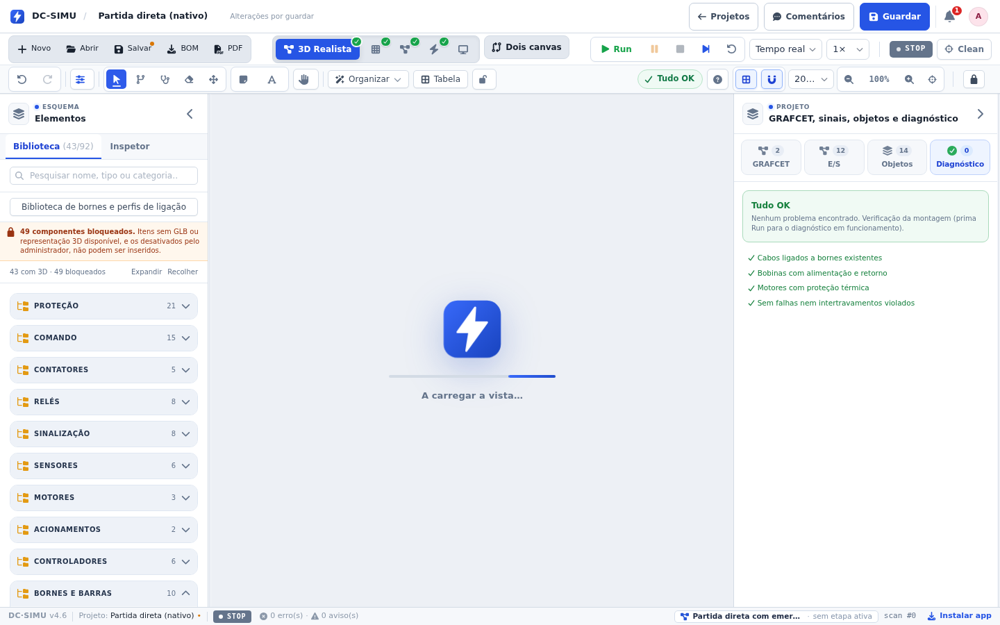

# Validação 2026-11-01 — Diagnóstico do exemplo nativo: 5 erros e 3 avisos → 0

## O que o utilizador viu

No projeto nativo «Partida direta» o painel de Diagnóstico abria com **5 erros · 3 avisos**:

- cabo W33 liga KM1:A2 (AC) a PS1:-V2 (DC) — classes incompatíveis;
- W17 e W18 (cabos de fase/potência) ligados aos bornes PE de XG, PS1 e M1;
- motor M1 — fase não identificada em U1, V1, W1;
- PS1:RDY1 e PS1:RDY2 sem cabo.

## As quatro causas (duas no exemplo, duas nas regras)

| # | Diagnóstico | Causa | Correção |
|---|---|---|---|
| 1 | W33 AC↔DC | A bobina do contactor WEG CWC09 é **AC** (ficha: 42 V 50 Hz) e estava pendurada no 0 V DC da fonte PS1 — erro elétrico verdadeiro, o diagnóstico estava certo | A bobina passa a ser comutada pelo contacto de relé Q0.0 do LOGO!, alimentado pela fase do comando (Q0.4 de Q0 + Q0.4 do neutro). O exemplo continua a fechar o contactor pelo CLP; muda a tensão do circuito de comando da bobina para a que o aparelho tem |
| 2 | W17/W18 «fase em borne PE» | Cabos de proteção gravados como `power`/`control` | O construtor do exemplo passa a gravá-los como `earth` (verde-amarelo já era a cor) |
| 3 | «fase não identificada no motor» | `computePhaseLabels` só propagava fase por pontes **fechadas**: com o contactor desligado não havia caminho XG→M1 | A identidade de fase passa a atravessar os polos dos aparelhos mesmo abertos — mas **só como recurso**: primeiro os caminhos vivos, depois a topologia nos bornes que ficaram sem identidade. Sem esta ordem, o inversor com dois contactores em paralelo passava a ler L1 na saída de ambos e perdia a inversão (o teste de reversão apanhou-o) |
| 4 | RDY1/RDY2 sem cabo | A regra exigia cabo em **todos** os bornes das fontes, incluindo contactos secos | A regra passa a verificar só bornes de alimentação (rede, saídas, retorno); contactos secos ficam fora |

Além disso, o tipo efetivo de um cabo passa a sair da cor quando esta é verde-amarelo: num projeto antigo com `kind` errado, um condutor de proteção deixa de ser acusado de «fase/potência». O contrário continua a acusar (um cabo preto num borne PE é erro).

## Verificação

| Verificação | Resultado |
|---|---|
| `npm run -s test:native-diagnostics` (novo) | 0 erros e 0 avisos no exemplo; PE é `earth`; A2 do KM1 não regressa ao 0 V DC; fases U1/V1/W1 = L1-L2-L3 com o contactor aberto e L1-L3-L2 com dois condutores trocados; e três controlos positivos (AC↔DC volta a acusar, preto num PE volta a acusar, `+V1` sem cabo volta a avisar) |
| `npm run -s test:native-diagnostics-ui` | no browser: o projeto carregado pela aplicação não tem diagnósticos e nenhuma das 8 mensagens antigas aparece no ecrã |
| `npm test` | todos os cenários, incluindo **reversão: motor gira anti-horário (L3-L2-L1)** — a regressão que a primeira tentativa introduziu |
| `npm run -s test:diagnostics`, `test:native-sim`, `test:native-wires-3d`, `test:style`, `tsc -b` | passam |

Os dois testes novos entraram no `test:ci`.

## Captura

Vista 3D Realista com o exemplo nativo carregado — «Tudo OK», 0 no mosaico do Diagnóstico e «0 erro(s) · 0 aviso(s)» na barra de estado:

## Nota de projeto

O exemplo também mudou de **circuito**, não só de diagnóstico: a bobina do CWC09 é AC e o LOGO! 12/24RC tem saídas a relé, por isso a ligação anterior (bobina AC no 0 V DC) era um erro elétrico real e não um falso positivo. Quem tiver o projeto guardado a partir da versão anterior mantém o seu JSON — a correção aplica-se ao exemplo de fábrica; os diagnósticos nos projetos já guardados continuam a apontar o problema até serem corrigidos no editor, como deve ser.

## Pendências

- O `test:commands-import` continua a precisar de fixtures externas (`/tmp/festo-ct`) e falha igual em `ed2f36e`; não é regressão desta alteração.
- `vite build` continua sem correr neste ambiente (memória); validação por `tsc -b` e testes.
