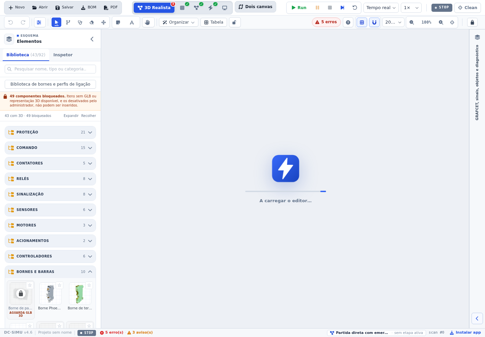
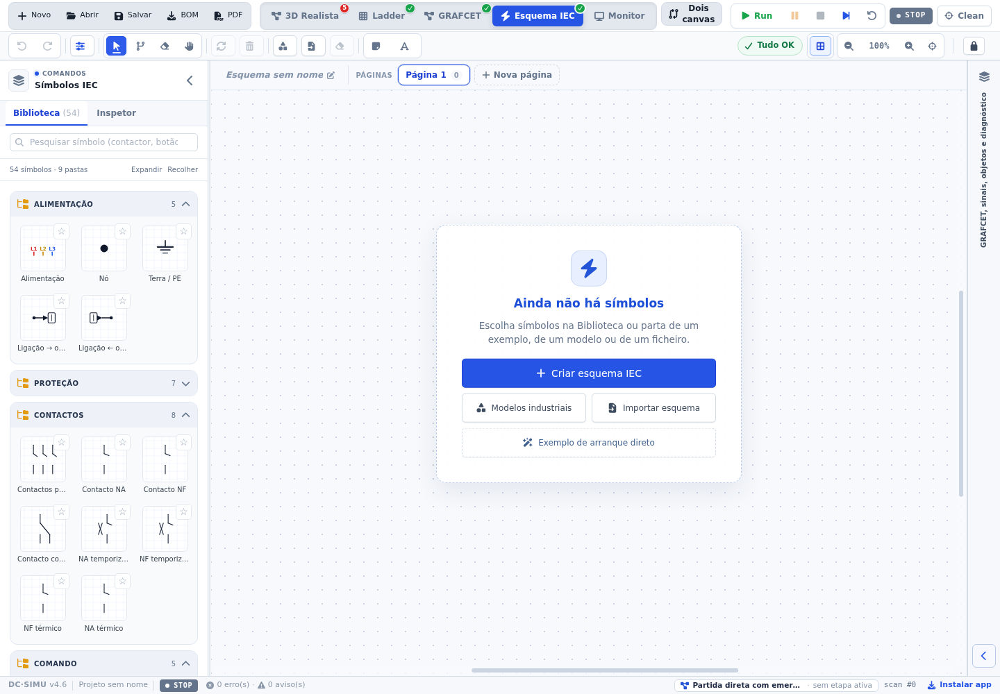
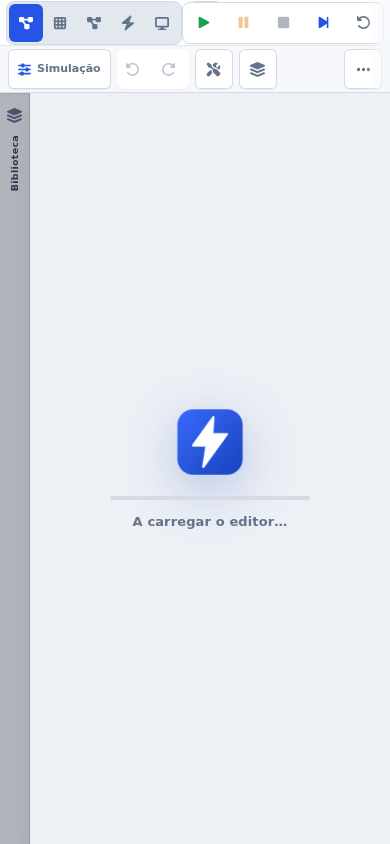

# Validação 2026-11-01 — Painel direito: 3D e IEC iguais ao GRAFCET

## Pedido

Duas queixas com capturas do painel direito («GRAFCET, sinais, objetos e diagnóstico»):

1. no 3D Realista e no Esquema IEC os separadores estavam diferentes dos do GRAFCET;
2. no 3D e no IEC, ao recolher o painel, não aparecia o nome do painel nem o botão de reabrir.

## O que estava errado

| Sintoma | Causa |
| --- | --- |
| Separadores em pastilha baixa (ícone ao lado do texto, sem contagens), contra os mosaicos do inspetor GRAFCET | O painel direito usava um desenho próprio (`dc-dock-tabs` em `index.css`) que só existia para o 3D/IEC; o GRAFCET usa `grafcet-tabs` (mosaicos com ícone + contagem e nome por baixo) |
| Régua recolhida sem nome e sem botão | `.pn-collapsed-rail` é `flex: 0 0 48px` — uma **largura**, pensada para o fluxo em linha. No painel direito a régua vive num contentor em **coluna**, por isso os 48 px passavam a ser a altura, e o `overflow: hidden` cortava o resto (restavam o ícone e uma faixa vazia) |
| Botão morto entre 768 e 1199 px | Nessa faixa o painel é absoluto por cima do canvas e a cortina `.dc-mobile-backdrop` (z-index 30, herdada da regra ≤1199 px) cobria a régua; o «A carregar…» do 3D (z-50) também passava por cima |
| Nome curto na régua | A régua dizia «GRAFCET, sinais e objetos»; o cabeçalho aberto diz «… e diagnóstico» |

## Implementação (`dc-simu` `cd4b4de`)

- **`src/components/RightDockTabs.tsx` (novo)** — separadores do painel direito com a anatomia do inspetor GRAFCET: quatro mosaicos iguais, `ícone + contagem` na 1.ª linha e o nome na 2.ª. As contagens vêm do estado real: etapas do GRAFCET, pontos de E/S (bornes I/Q do PLC do esquema ou E/S virtuais no 3D; aparelhos de entrada/saída no IEC) e objetos do projeto. O Diagnóstico mostra `erros + avisos` com ícone verde/âmbar/vermelho, sem tingir o mosaico quando está inativo.
- **`src/App.tsx`** — passa a usar `RightDockTabs`; o título do painel vive numa constante (`RIGHT_DOCK_TITLE`) usada no cabeçalho **e** na régua; a régua ganha `aria-controls="dc-right-dock"` (o `
` do painel tem esse `id`). A cortina do workspace só é desenhada em modo compacto (telemóvel), nunca em tablet/PC.
- **`src/styles/panel-system.css`** — correção de raiz da régua: `> .pn-shell-rail` no painel direito passa a `flex: 1 1 auto; width: 100%` (preenche a largura e estica em altura), o nome ganha `max-height: calc(100% - 92px)` e o botão passa a `margin-top: auto`, garantindo que **nunca** fica fora do painel. Entre 768 e 1199 px o painel sobe para `z-index: 52`, acima do «A carregar…» do 3D.
- **`src/styles/sim-dock-refine.css`** — desenho dos `.dc-dock-tab` (mosaicos 9 px de raio, fundo `--pn-bg-2`, ativo `--pn-brand-soft`, alvo 50 px; 56 px no telemóvel). `src/index.css` deixa de ter as regras antigas do painel direito.

## Verificações

Render visual confirmado em Chromium (Playwright) com o projeto sintético «Partida direta», a **1440, 1180, 1024, 820, 768 e 390 px**, no 3D Realista e no Esquema IEC:

- separadores: 4 mosaicos de 87 × 51 px a 1440 px (56 px de altura a 390 px), ícone e contagem por cima do nome, mesma largura entre eles; o inspetor GRAFCET medido no mesmo instante mantém a mesma anatomia;
- régua recolhida: 887 px de altura a 1440 px, nome «GRAFCET, sinais, objetos e diagnóstico» inteiro dentro dos limites, botão 34 × 34 px (28 × 32 px abaixo de 1200 px) sempre visível — capturas abaixo;
- clicar na régua reabre o painel em todas as larguras; nenhuma cortina em tablet/PC; no telemóvel a gaveta mantém cortina e fecha ao tocar fora;
- cada separador muda mesmo o conteúdo (E/S, Objetos, Diagnóstico e GRAFCET) nas duas vistas, sem erros JavaScript.

Automatizado: `npm run test:right-dock-ui` (novo, 183 linhas, incluído no `test:ci`) executa esta matriz e passa por inteiro. Também verdes: `tsc -b`, `npm test` («TODOS OS TESTES PASSARAM»), `npm run test:style`.

Não executado neste ambiente: `vite build` (o sandbox de 2 GB esgota a heap do Node a meio da minificação — falha de memória do ambiente, não do código) e `test:tablet-parity-ui` (exige o servidor de pré-visualização em `:4173`).

## Capturas

`evidence-right-dock/` (3D Realista e Esquema IEC recolhidos a 1440 px; gaveta a 390 px).

## Pendências

- Confirmar no PC e no tablet reais a régua recolhida e os mosaicos (o ambiente de verificação é headless).
- `test:workspace-panels-ui` e `test:toolbar-ui` já falhavam antes desta alteração (confirmado com `git stash`); continuam por rever — ver `UI-SUITES-02` no [[Backlog]].
