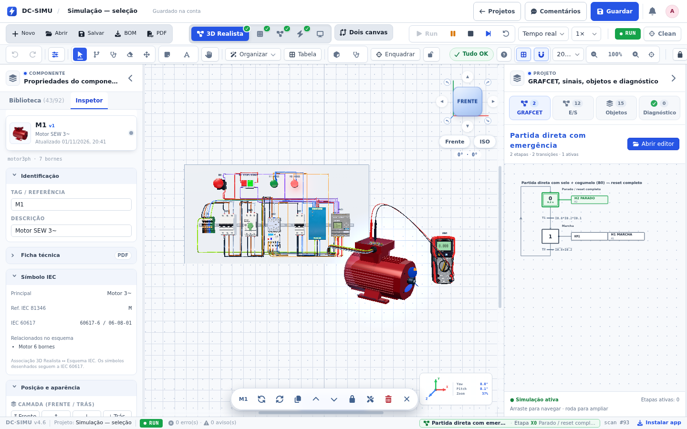

# Validação 2026-11-01 — Remover o dedo 3D ao simular

## Resultado

Implementado e testado no âmbito de [[Task-2026-11-01-Remover-Dedo-3D-Simulacao]]. A mão/dedo indicador deixa de existir na cena da visualização 3D. O cursor normal volta a ser visível em RUN, pausa e paragem. A remoção inclui componente, importação, montagem, atributo de palco e CSS; não é apenas um `visible=false`.

Não foram alterados os motores elétricos, os projetos guardados, os modelos de equipamento, as suas animações, as condições de atuação ou o bloqueio de edição. A demonstração da página inicial já excluía o dedo e mantém essa exclusão.

## Ambiente e método

- Data: 2026-11-01; Linux, Node.js **22.22.2**, npm **10.8.2**.
- Dependências restauradas com `npm ci`, sem alterarficheiros lock; Chromium do Playwright **1.64.1**, build **156.0.8078.4**, renderização software.
- Projeto sintético nativo «Partida direta com emergência», carregado num projeto de teste local; navegador a **1440 × 900**.
- Vite local, perfil de browser isolado, API/remotes bloqueados, service workers bloqueados e consulta `/version.json` bloqueada. Não foram usados dados de produção, credenciais nos testes nem workflows externos.
- Código trabalhado em `03-Projects/DC-Simu/dc-simu`, o submódulo do cofre. O checkout exterior duplicado foi recolhido para este caminho; históricos e configuração Maestri preservados.

## Verificações do produto

| Comando | Resultado |
| --- | --- |
| `npm run typecheck` | **PASS** após a remoção |
| `npm run test:sim-cursor` | **PASS — 8 verificações**; falhou antes da remoção, como esperado |
| `npm run test:sim-select-3d-ui` | **PASS — 17 verificações** no browser |
| `npm test` | **PASS — 733 verificações PASS**, resultado final «TODOS OS TESTES PASSARAM» |
| `npm run test:native-sim` | **PASS — 11 verificações**, incluindo START/STOP, retenção do contactor, sinalização e rotação/paragem do motor |
| `npm run test:interactables` | **PASS** |
| `npm run test:motion` | **PASS** |
| `npm run test:pinch` | **PARCIAL:** zoom e `pinch-dom` passam; `commands-touch-smoke` falha numa asserção do painel GRAFCET já presente na base (ver abaixo) |
| `npm run test:style` | **PASS** |
| `git diff --check` | **PASS** |

A regressão de browser confirma, separadamente em **RUN, PAUSA e STOP**:

1. Zero objetos `sim-finger` na cena, mesmo após mover o rato sobre o canvas.
2. Cursor calculado `default`, nunca `none`; ausência de `data-sim-finger`.
3. Transição de estado correta.

Confirma ainda carregamento dos 38 cabos, seleção de cabo/componente em RUN, impossibilidade de mover o componente nesse estado e zero exceções JavaScript. Os comandos START/STOP foram verificados pelo teste do motor nativo e pela preservação das ligações no código; o ensaio exploratório de clicar nas tampas no browser não foi usado como evidência de aprovação.

### Verificações do cofre

- `npm test`: **18 passaram, 0 falharam, 27 ignoradas**. Os casos ignorados são os testes PowerShell/Windows, não executáveis neste Linux; não são contados como aprovados.
- `npm run check`: **PASS**, 272 notas Markdown, 660 ligações verificadas, três workflows revistos estaticamente e zero erros. Não foram executados nem importados workflows n8n.
- `git diff --check`: **PASS**.

### Evidência visual

- [Antes](evidence-sim-cursor/antes-run-1440.png): a mão/dedo aparece sobre o canvas em RUN.
- Depois: o mesmo projeto, vista e estado não mostram a mão/dedo; equipamento, cabos, painéis e diagnóstico mantêm-se.

As duas capturas são de testes locais com dados sintéticos. A captura do sistema não inclui o ponteiro do rato; a visibilidade do cursor é verificada pelas asserções de estilo calculado, não pela imagem.

## Falhas anteriores e correções de suporte

- **Teste de interface interrompido por navegação:** a execução inicial de `test:sim-select-3d-ui` falhou antes das asserções porque a consulta de versão recebia o HTML de reserva e podia desencadear uma recarga. O teste agora bloqueia service workers e `/version.json`, como outros smokes do produto. Depois desta correção, a base passou os seis checks originais e a versão alterada passou os 17 checks.
- **Pinça / contrato estático do GRAFCET:** `commands-touch-smoke` falha em «no telemóvel o GRAFCET só tem o painel lateral completo em baixo». A mesma falha foi reproduzida com `src/` e o teste extraídos de `7593e6a`, antes da remoção. Não é uma regressão deste incremento e não foi corrigida nesta tarefa. Permanece pendente alinhar o teste à interface atual.
- **Memória do runner:** executar tipos e browser em paralelo excedeu a capacidade prática deste runner de aproximadamente 2 GiB; as execuções foram interrompidas e repetidas **sequencialmente**, com sucesso nos checks indicados. Não se atribuiu essa limitação ao produto.
- **Build de produção:** não executado neste runner; não é apresentado como teste passado. A validação de tipos passou, mas não substitui o build Vite nem a confirmação de deploy.
- **Cofre:** `npm run check` encontrou cinco notas antigas sem metadados completos. Foram acrescentados apenas frontmatter/updated em `2026-10-31-layout-comandos`, `Task-2026-10-31-Referencias-Simbolos-Comandos`, `Task-2026-10-31-Torre-Tampa-Bucim`, `Task-2026-10-31-Variantes-QElectroTech` e `Validation-2026-10-31-Esquema-Layout-Canvas`. O conteúdo e os resultados históricos não foram reescritos nem apresentados como novos testes.

## Ficheiros principais

- Código: `src/three/Panel3D.tsx`, `src/styles/panel3d-editor.css`; remoção de `src/three/SimFinger3D.tsx`.
- Regressões: `scripts/sim-cursor-smoke.ts` (novo), `scripts/sim-select-3d-ui-smoke.mjs` (reforçado), `package.json` (novo script e inclusão em `test:ci`).
- Contexto técnico: `README.md`, `docs/TOOLBAR-ATALHOS-SIMULACAO.md`.
- Cofre: tarefa, esta validação, [[Design-Principles]], [[Decision-Log|DC-ADR-082]], [[Backlog|SIM-CURSOR-01]], índice e ponteiro do submódulo.
- O hook de commit existente atualiza `release-stamp.json`; não foi desativado.

## Comunicação Obsidian / Maestri

Esta nota e os princípios de design são o ponto de handoff para programação e QA. Os papéis continuam a ser instruções reutilizáveis, não agentes ativos. Não havia `MAESTRI_PIPE` nem CLI Maestri disponível; nenhum terminal, workflow n8n, serviço externo ou configuração pessoal foi alterado.

## Publicação e pendências

Âmbito autorizado e publicado no GitHub, com confirmação por `git ls-remote`:

1. `dc-simu`: **`e9e2a9d36bd7f4db280138df7c2e0442f675257b`** (`e9e2a9d`), publicado primeiro em `main`.
2. BrainNet: **`7310d0371e318072a093843477372c2a499d7aad`** (`7310d03`), publicado em `main` com o submódulo a apontar exatamente para o commit acima. O recibo de publicação é guardado num commit documental seguinte.

Os dois pushes foram confirmados. Um push não comprova deploy Vercel/Docker; o ambiente de produção não foi inspecionado nem alterado manualmente.

Pendente fora do âmbito: corrigir o contrato estático de `commands-touch-smoke`, executar build de produção num runner com memória suficiente e confirmar o ambiente/commit de qualquer deploy. Não há aprovação humana adicional de lançamento implícita nestes testes.

## Segurança

A chave fornecida na conversa não foi escrita em notas, código, URLs de remote ou configuração Git persistida. Recomendada a sua revogação/substituição no GitHub por ter sido exposta na conversa.
