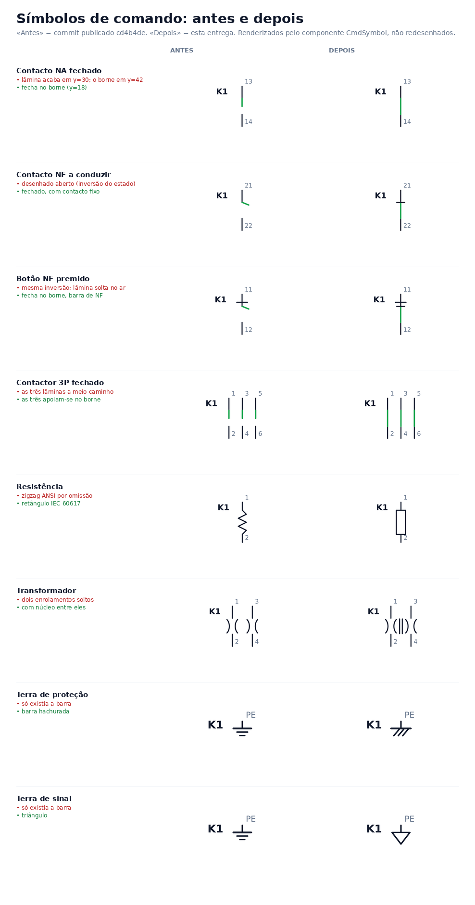
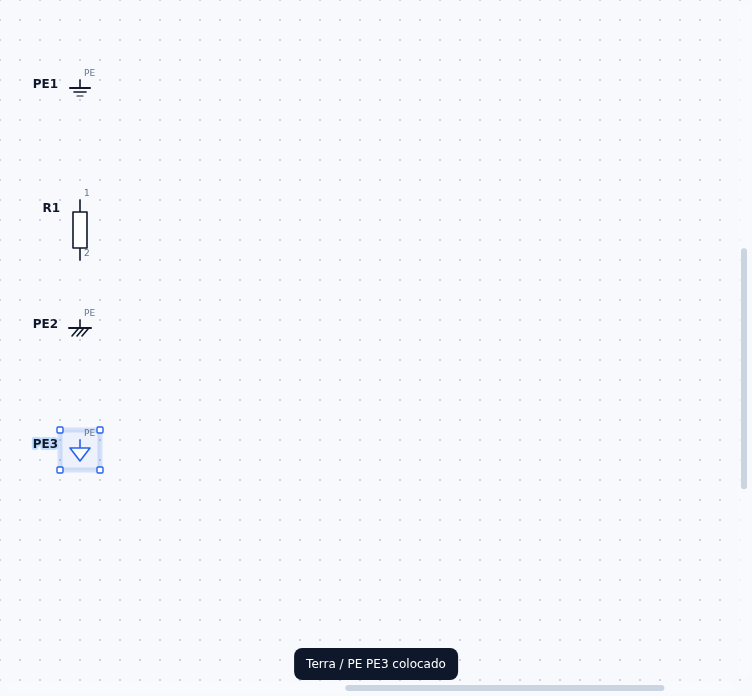
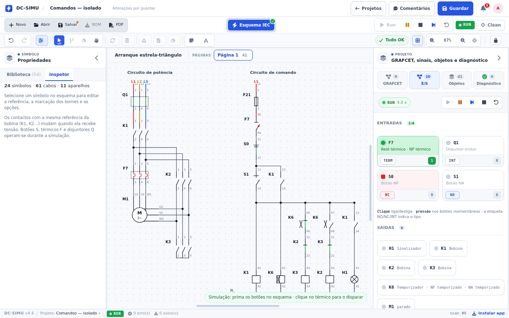

# Validação 2026-11-01 — Símbolos de comando: estado de condução, IEC e terras

## Pedido

Depois de avaliar a folha de símbolos SVG colada pelo utilizador em [[Task-2026-11-01-Reaproveitamento-Folha-Simbolos-SVG]], implementar o que essa avaliação propôs (correções de desenho de risco nulo) e publicar nos dois repositórios.

## Defeitos encontrados no caminho

A avaliação tinha identificado um: a lâmina do contacto, mesmo fechada, terminava em `y=30` e o borne inferior só começava em `y=42`. Ao escrever o teste geométrico apareceu um segundo, mais grave:

| # | Defeito | Efeito no ecrã |
|---|---|---|
| 1 | Lâmina do contacto fechada a 12 px do borne | Um contacto a conduzir desenhava-se aberto |
| 2 | `st.closed` é o estado de **condução** (vem de `isClosed`), mas o desenho invertia-o outra vez para os NF | Um contacto **NF a conduzir** desenhava-se aberto, e um NF aberto desenhava-se fechado — exactamente ao contrário |

O defeito 2 afetava `contactNC`, `pushNC`, `timedNC`, `thermalNC`, `limitNC` e `emergency`. Não era só cosmético: era a leitura errada do estado de segurança de um esquema (um NF que se abre a comandar é a base de qualquer paragem).

## Implementação

- **Contactos** (`contactBody`, `threePole`): a lâmina apoia-se no borne inferior (`y=42`) e, a conduzir, sobe até ao borne superior (`y=18`); aberta, roda para a direita com 7 px de intervalo. `st.closed` passou a ser lido como condução, sem inversão; sem estado (miniaturas da paleta) desenha-se o repouso — NF a conduzir, NA aberto. O NF ganhou a barra transversal do contacto fixo, para se distinguir do NA nos dois estados.
- **Resistência**: o desenho por omissão passa a ser o retângulo IEC 60617. O zigzag ANSI fica como variante explícita (`symbolStyle: 'ansi'`), escolhida no inspetor em «Desenho do símbolo».
- **Transformador**: núcleo (duas linhas verticais entre os enrolamentos).
- **Terra**: três variantes no mesmo tipo e no mesmo borne PE — barra (por omissão), proteção (hachurada) e sinal (triângulo) — com campo novo `groundVariant` no componente e seletor «Tipo de terra» no inspetor.

Nada disto altera terminais, cabos, redes ou simulação: são desenho e uma propriedade opcional persistida no JSON.

## Verificações

| Verificação | Resultado |
|---|---|
| `npx tsc -b` | passa (0 erros) |
| `npm run -s test:commands-symbols` (novo) | 10 asserções — contactos NA/NF, três polos, resistência IEC/ANSI/QET, núcleo, três terras, persistência, e desenho de **todos** os tipos sem `NaN` |
| `npm run -s test:commands-symbols-ui` (novo, browser) | 9 verificações — seletor de terra no inspetor, três desenhos distintos no esquema, variante persistida, resistência IEC vs ANSI |
| `npm run -s test:commands-ui` | 29 verificações — construção, cabos, nó, RUN/STOP, estrela-triângulo; sem erros JavaScript |
| `npx tsx scripts/commands-smoke.ts` | todos os testes de simulação de comandos |
| `npx tsx scripts/qet-symbols-smoke.tsx` | variantes QElectroTech continuam a renderizar diferente e a simular igual |
| `npm test`, `npm run -s test:style`, `npm run -s test:native-wires-3d` | passam |

Os dois testes novos entraram no `test:ci` (`test:commands-symbols` e `test:commands-symbols-ui`).

## Capturas

Antes (commit publicado `cd4b4de`) e depois, renderizados pelo próprio componente `CmdSymbol`:

Três terras e a resistência IEC no editor real:

O exemplo estrela-triângulo continua a simular (contactos, bobinas e temporizado desenhados com o novo traço):

## Pendências

- As peças novas da folha — `varistor`, indutor, optoacoplador/SSR e as fichas — **não** foram implementadas: pedem tipo novo em `CMD_PARTS`, paleta, normalização de importação e ícones. Continuam em análise na nota da tarefa.
- Falhas anteriores a esta entrega, não regressões: `test:commands-import` precisa de `/tmp/festo-ct` (formatos Cade Simu/Festo) e falha igual em `cd4b4de`; os 21 erros de frontmatter e os 2 links de `docs/AI-ASSISTANCE.md` já existiam no vault.
- O `vite build` continua a não correr neste ambiente (sem memória); a validação foi feita com `tsc -b` e os testes acima.
